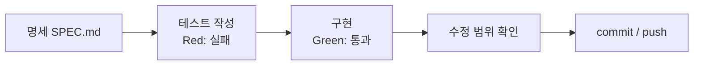

# 리뷰 온도계

> © 2026 김연지. All rights reserved. 수강생 개인 학습용 · 무단 강의·복제·배포·수정 금지 · [LICENSE.md](LICENSE.md)

이 문서는 수업 저장소의 첫 화면입니다. 무엇을 만드는지, 어떤 명령을 복사해 쓰는지, 다른 문서가 어디 있는지 적었습니다.

가상 쇼핑몰 하루마켓의 리뷰 한 건과 별점을 넣으면, 긍정/부정과 리뷰 온도(0~100℃), 별점과 내용이 반대인지 알려 주는 API와 화면입니다. 하루마켓은 수업용 가상 서비스입니다.

- 개발요청서: [REQUEST.md](REQUEST.md)
- 공식 명세서(무엇을 만들지 적은 문서): [SPEC.md](SPEC.md) (1차), `SPEC_COUPON.md` (2차, 쿠폰 명세서. 세션 4에서 직접 씁니다)

Python, VS Code 확장, agy는 세션 1에서 설치합니다. 순서는 [docs/01-setup-card.md](docs/01-setup-card.md) B절을 따릅니다. 설치가 끝나면 블록 ①로 확인합니다.

## 오늘 만드는 순서

매 세션 같은 순서로 일합니다.



세션 3에서는 이 순서에 "MCP·스킬을 찾아 붙이기"를 더합니다. 세션 4에서는 명세를 직접 쓰는 것부터 시작합니다.

## 안전 규칙

- AI 채팅에 비밀번호, API 키, 실제 고객 정보, 회사 코드는 넣지 않습니다.
- agy 로그인 때 Google 비밀번호는 로그인 화면에만 입력합니다. AI 채팅에는 넣지 않습니다.
- 결제 수단은 어디에도 등록하지 않습니다.
- MCP 서버를 켤 때 뜨는 신뢰 확인 창에서는 명령이나 주소를 읽습니다. 내가 직접 넣은 것만 허락하고, 처음 보는 것은 허락하지 않습니다.

## 로컬 실행

처음이라면 [docs/01-setup-card.md](docs/01-setup-card.md)를 순서대로 따라 합니다. 요약은 아래와 같습니다.

- 파이썬은 3.11 이상(3.12 권장)이 필요합니다. python.org에서 설치하고(Windows는 Add python.exe to PATH 체크), `python --version`(Mac은 `python3 --version`)으로 확인합니다.
- VS Code를 처음 열면 "이 폴더를 신뢰합니까?" 창이 뜹니다. Yes, I trust를 누르고, 추천 확장 알림은 닫습니다.
- VS Code에 확장 두 개가 필요합니다. 왼쪽 Extensions(네모 4개 아이콘)에서 `Python`(Microsoft)과 `GitHub Copilot Chat`을 검색해 Install 합니다.
- Mac은 편집기 단축키에서만 `Ctrl` 대신 `Cmd`를 씁니다. 터미널의 서버 종료 `Ctrl+C`는 Mac도 `Ctrl`입니다.
- 내 PC에서는 `MODEL_REPO`를 입력하지 않습니다. 모델 저장소 이름은 코드(`app/sentiment.py`)에 들어 있습니다.

`(.venv)`는 가상환경(이 프로젝트만 쓰는 파이썬 상자)이 켜졌다는 표시입니다.

macOS:

```bash
python3 -m venv .venv
source .venv/bin/activate
pip install -r requirements.txt
uvicorn app.main:app --reload
```

Windows PowerShell:

```powershell
Set-ExecutionPolicy -Scope CurrentUser RemoteSigned
python -m venv .venv
.venv\Scripts\Activate.ps1
pip install -r requirements.txt
uvicorn app.main:app --reload
```

- `Set-ExecutionPolicy`는 한 번만 합니다. 묻는 창에는 `Y`를 씁니다.
- `Activate.ps1`이 안 되면 터미널 오른쪽 위 ▼ → Command Prompt를 열고 `.venv\Scripts\activate.bat`를 칩니다.
- Windows에서 `python`을 치면 Microsoft Store가 열릴 때는 `py`를 씁니다.

브라우저에서 http://localhost:8000 을 엽니다. API 문서는 http://localhost:8000/docs 입니다.

Copilot Chat은 VS Code 맨 위 가운데 검색창 옆의 채팅 아이콘으로 엽니다. 단축키는 Windows `Ctrl+Alt+I`, Mac `Ctrl+Cmd+I`입니다. 모드 드롭다운은 입력창 아래에 있습니다. Ask와 Agent가 보이면 성공입니다(Plan은 버전에 따라 보입니다).

agy는 프로젝트 폴더의 터미널에서 `agy`를 입력해 켭니다. 처음 켤 때 본인 Google 계정으로 로그인합니다.

git 이메일: Public 저장소에서는 commit에 이메일이 보입니다. 원하지 않으면 GitHub Settings → Emails의 noreply 주소를 씁니다.

## 테스트

`review-thermo` 폴더에서 실행합니다.

```bash
pytest -v
```

테스트는 가짜 AI 부품을 쓰므로 모델도 인터넷도 필요 없습니다. pytest가 처음이라면 [docs/02-pytest.md](docs/02-pytest.md)를 먼저 읽습니다.

## 명령 복사 블록

GitHub 화면에서 코드 블록 오른쪽 위의 복사 버튼으로 복사해 터미널에 붙여 넣습니다. 번호는 수업 슬라이드의 "README ⑥ 복사" 표시와 같습니다. ⑫⑮는 세션 3에서, ⑭⑯은 세션 4에서, ⑰은 선택 과제에서 새로 쓰는 블록입니다.
꺾쇠 `< >`는 빼고 내 값으로 바꿉니다. 예: `<내아이디>`는 `haru123`.

① 설치 확인 (Mac은 `python --version` 대신 `python3 --version`)

```text
python --version
git --version
code --version
agy --version
```

①-2 agy 설치 · Windows PowerShell (끝나면 새 터미널에서 `agy --version`)

```powershell
irm https://antigravity.google/cli/install.ps1 | iex
```

①-2 agy 설치 · macOS

```bash
curl -fsSL https://antigravity.google/cli/install.sh | bash
```

② 저장소 받기 (`<내아이디>` 자리에 내 GitHub 아이디를 씁니다)

```text
git clone https://github.com/<내아이디>/review-thermo.git
cd review-thermo
code -r .
```

③ Git 이름 설정 (처음 한 번만)

```text
git config --global user.name "내 이름"
git config --global user.email "GitHub 가입 이메일"
```

④ 가상환경 · macOS

```bash
python3 -m venv .venv
source .venv/bin/activate
pip install -r requirements.txt
```

⑤ 가상환경 · Windows PowerShell

```powershell
python -m venv .venv
.venv\Scripts\Activate.ps1
pip install -r requirements.txt
```

### uv나 Poetry를 쓰는 경우 (선택)

④⑤의 `python -m venv`와 `pip install` 대신 uv나 Poetry로 같은 환경을 만들 수 있습니다. 어느 쪽을 쓰든 결과는 같고, 처음 쓰는 분은 ④⑤만 따라 해도 됩니다. 설치가 끝나면 새 터미널을 엽니다.

uv 설치 · Windows PowerShell

```powershell
powershell -ExecutionPolicy ByPass -c "irm https://astral.sh/uv/install.ps1 | iex"
```

uv 설치 · macOS

```bash
curl -LsSf https://astral.sh/uv/install.sh | sh
```

uv로 패키지 설치와 실행 (Windows · macOS 공통)

```text
uv sync
uv run uvicorn app.main:app --reload
uv run pytest -v
```

Poetry 설치 · Windows PowerShell

```powershell
(Invoke-WebRequest -Uri https://install.python-poetry.org -UseBasicParsing).Content | py -
```

Poetry 설치 · macOS

```bash
curl -sSL https://install.python-poetry.org | python3 -
```

Poetry로 패키지 설치와 실행 (Windows · macOS 공통)

```text
poetry install
poetry run uvicorn app.main:app --reload
poetry run pytest -v
```

- `uv sync`와 `poetry install`은 `.venv` 폴더를 만들고 패키지를 설치합니다. 가상환경을 켜는 `Activate` 명령은 필요 없습니다.
- 이후 단계의 `python`, `pytest`, `uvicorn` 명령 앞에 `uv run`(또는 `poetry run`)을 붙입니다.
- VS Code에서 인터프리터는 `.venv`를 고릅니다(세 방법 모두 `.venv`를 만듭니다).
- 패키지 목록은 `requirements.txt`(pip)와 `pyproject.toml`(uv·Poetry) 두 곳에 있습니다.

⑥ 서버 켜기 (브라우저에서 http://localhost:8000)

```text
uvicorn app.main:app --reload
```

⑦ 테스트

```text
pytest -v
```

⑧ 수정 범위 확인 (`git restore`는 `tests/`나 `SPEC.md`가 바뀌었을 때만)

```text
git diff --stat
git status
git restore tests/ SPEC.md
```

⑨ 저장하고 올리기 (`"메시지"` 자리에 내 설명을 적습니다)

```text
git add .
git commit -m "메시지"
git push
```

⑩ 따라잡기 (`<브랜치>` 자리에 수업에서 알려 주는 이름을 씁니다. 예: `cp3-tdd`)

```text
git fetch origin
git checkout origin/<브랜치> -- .
```

⑪ 공식 명세 받기

```text
git fetch origin
git checkout origin/cp2-spec -- SPEC.md
```

⑫ MCP 서버 추가 (세션 3)

Context7은 `npx`로 내 PC에서 돌리는 방식과 인터넷의 서버에 접속하는 http 방식이 있습니다. 두 방식을 모두 붙여 봅니다. 먼저 `npx`가 필요하므로 Node.js를 설치합니다(18 이상).

Windows PowerShell:

```powershell
winget install OpenJS.NodeJS.LTS
```

설치가 끝나면 터미널(VS Code 포함)을 모두 닫았다가 다시 엽니다.

macOS:

```bash
brew install node
```

Homebrew가 없으면 https://nodejs.org 에서 LTS 설치 파일을 받아 설치합니다. 설치 뒤 터미널(VS Code 포함)을 다시 엽니다.

확인(공통). 둘 다 버전 숫자가 나오면 됩니다.

```text
node -v
npx -v
```

PowerShell에서 `npx`가 실행 정책 오류를 내면 세션 1에서 한 `Set-ExecutionPolicy -Scope CurrentUser RemoteSigned`를 다시 실행합니다.

VS Code에서 서버를 추가하는 방법은 두 가지입니다. 편한 쪽을 하나 고릅니다.

방법 1. 메뉴로 추가합니다.

1. Windows `Ctrl+Shift+P`, Mac `Cmd+Shift+P`를 누르고 `MCP: Add Server`를 고릅니다.
2. `Command (stdio)`(또는 `Browse MCP Servers`)를 고르고, npm 방식은 명령에 `npx -y @upstash/context7-mcp`를 붙여 넣습니다.
3. 이름을 `context7`로 하고, 저장 위치는 `Workspace`를 고릅니다.
4. `.vscode/mcp.json` 파일이 만들어집니다.

방법 2. 프로젝트 맨 위에 `.vscode` 폴더를 만들고 `.vscode/mcp.json` 파일에 아래 내용을 붙여 넣습니다. npm 방식(`context7`)과 http 방식(`context7-http`)이 함께 들어 있습니다.

```json
{
  "servers": {
    "context7": {
      "command": "npx",
      "args": ["-y", "@upstash/context7-mcp"]
    },
    "context7-http": {
      "type": "http",
      "url": "https://mcp.context7.com/mcp"
    }
  }
}
```

서버를 켭니다. `Ctrl+Shift+P`(Mac은 `Cmd+Shift+P`) → `MCP: List Servers` → 서버 이름 → `Start Server`. 서버를 켤 때 뜨는 신뢰 확인 창에서는 명령이나 주소를 읽고 허락합니다. 그다음 Copilot Chat을 Agent 모드로 두고 도구 아이콘을 눌러 도구가 보이는지 확인합니다.

⑬ 되돌리고 다시 올리기

```text
git revert HEAD --no-edit
git push
```

⑭ 공식 쿠폰 명세와 계약 테스트 받기 (세션 4, 비교용)

내가 쓴 `SPEC_COUPON.md`는 그대로 두고, 공식 명세는 `SPEC_COUPON_OFFICIAL.md`라는 다른 이름으로 받습니다.

```text
git fetch origin
git checkout origin/cp5-coupon-spec -- SPEC_COUPON_OFFICIAL.md tests/test_api_coupon.py
```

비교가 끝나면 agent에게 이 두 파일을 지워 달라고 합니다. 비교용이라서 commit 하지 않습니다. 지운 뒤 테스트를 돌려 내가 쓴 테스트가 모두 통과하는지 확인합니다.

⑮ agy MCP 설정 (세션 3, 선택)

agy는 프로젝트 폴더의 `.agents/mcp_config.json` 파일을 읽습니다. 프로젝트 맨 위에 `.agents` 폴더가 이미 있으니, 그 안에 파일을 만듭니다.

Windows PowerShell:

```powershell
code .agents\mcp_config.json
```

macOS:

```bash
code .agents/mcp_config.json
```

열린 파일에 아래 내용을 붙여 넣습니다. npm 방식(`context7`)과 http 방식(`context7-http`)이 함께 들어 있습니다.

```json
{
  "mcpServers": {
    "context7": {
      "command": "npx",
      "args": ["-y", "@upstash/context7-mcp"]
    },
    "context7-http": {
      "serverUrl": "https://mcp.context7.com/mcp"
    }
  }
}
```

저장한 뒤 agy를 다시 켜고 `/mcp list`로 확인합니다.

모든 프로젝트에서 같이 쓰고 싶으면 내 계정 폴더의 `~/.gemini/config/mcp_config.json`에 같은 내용을 넣을 수도 있습니다. 오늘은 프로젝트 안의 파일을 씁니다. 파일에 이미 내용이 있으면 `mcpServers` 안에 위 두 서버 부분만 추가합니다.

⑯ 수정 범위 확인 (세션 4: 쿠폰. `git restore`는 `tests/`나 `SPEC_COUPON.md`가 바뀌었을 때만)

```text
git diff --stat
git status
git restore tests/ SPEC_COUPON.md
```

⑰ 새 프로젝트 폴더 만들기 (선택 과제. review-thermo의 서버·agy·가상환경을 끈 뒤)

macOS:

```bash
cd ..
mkdir review-cleanbot && cd review-cleanbot
cp ../review-thermo/docs/04-cleanbot-request.md REQUEST.md
python3 -m venv .venv
source .venv/bin/activate
pip install pytest
mkdir tests
git init
printf '.venv/\n__pycache__/\n' > .gitignore
code -r .
```

Windows PowerShell:

```powershell
cd ..
mkdir review-cleanbot; cd review-cleanbot
copy ..\review-thermo\docs\04-cleanbot-request.md REQUEST.md
python -m venv .venv
.venv\Scripts\Activate.ps1
pip install pytest
mkdir tests
git init
Set-Content .gitignore ".venv/","__pycache__/"
code -r .
```

## 수업 자료

파일 이름 앞 숫자는 쓰는 세션입니다. `00`은 하루 내내 옆에 두고 보는 자료입니다.

| 세션 | 실습 자료 |
|---|---|
| 00 (항상) | [개념 노트](docs/00-concepts.md) · [용어 사전](docs/00-glossary.md) · [화면 메시지 사전](docs/00-troubleshooting.md) |
| 1 | [환경설정 카드](docs/01-setup-card.md) · [Copilot과 agy 사용 안내](docs/01-copilot-guide.md) · [프롬프트 시트](docs/01-prompt-sheet.md) |
| 2 | [pytest 소개](docs/02-pytest.md) |
| 3 | 별도 문서 없음. 내가 만드는 `.vscode/mcp.json`, `.agents/mcp_config.json`과 `.agents/skills/` 폴더를 씁니다 |
| 4 | 별도 문서 없음. 내가 쓰는 `SPEC_COUPON.md`를 씁니다. 주소와 요청·응답 모양은 지금 서비스 코드(화면이 부르는 곳)를 AI가 읽고 알려 줍니다 |
| 선택 과제 | [3차 요청서 · 리뷰 클린봇](docs/04-cleanbot-request.md) |
