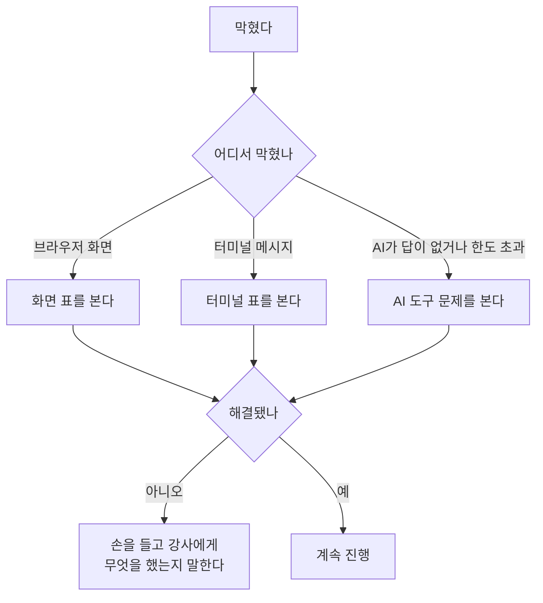
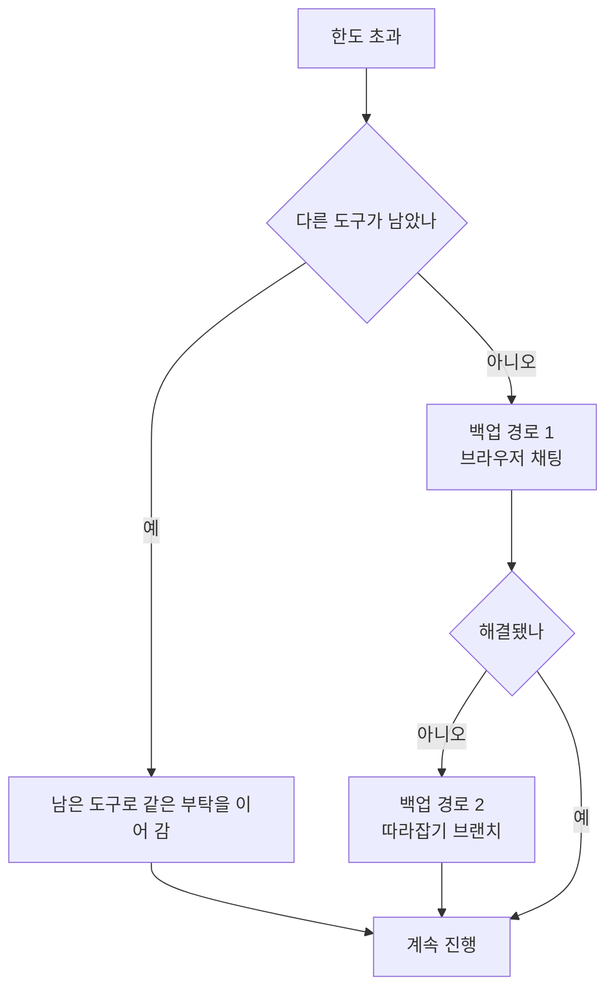
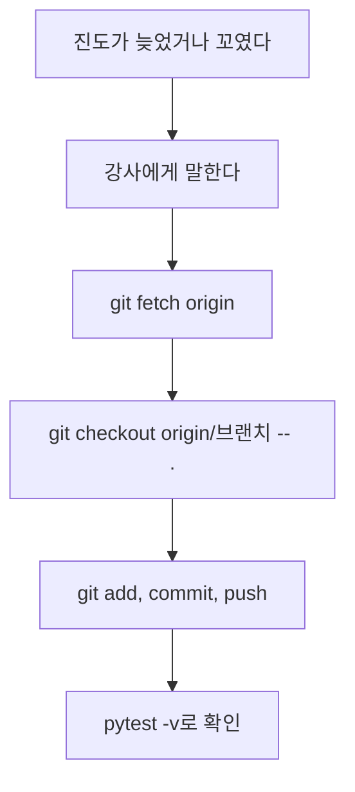

# 화면 메시지 사전

> © 2026 김연지. All rights reserved. 수강생 개인 학습용 · 무단 강의·복제·배포·수정 금지 · [LICENSE.md](../LICENSE.md)

이 문서는 막혔을 때 먼저 보는 표입니다. "메시지 → 뜻 → 할 일" 순서로 적었습니다. 무엇을 했는지 알려 주면 강사가 더 빨리 도와줍니다.

> 안전 규칙
> - AI 채팅에 비밀번호, API 키, 실제 고객 정보, 회사 코드는 넣지 않습니다.
> - 결제 수단은 어디에도 등록하지 않습니다.

## 어디서 막혔나

먼저 어느 쪽 문제인지 고릅니다.



## 화면(브라우저)에서 보이는 것

| 메시지 | 뜻 | 할 일 |
|---|---|---|
| 422 / "입력을 확인해 주세요" | 보낸 입력이 규칙에 안 맞음 (빈 글, 별점 6 등) | 글은 1~500자, 별점은 1~5로 고칩니다 |
| 501 "아직 구현되지 않았어요" | 정상입니다. 해당 함수를 아직 안 만들었습니다 | 이번 세션의 구현 단계까지 진행합니다 |
| "쿠폰 API가 아직 없어요" (쿠폰 버튼) | 정상입니다. 세션 4에서 쿠폰 API를 만들기 전입니다 | 내가 쓴 `SPEC_COUPON.md`를 보고 AI와 만듭니다. 만든 뒤에도 나오면 서버를 껐다 켜고(`Ctrl+C` → README 블록 ⑥) 주소가 `POST /v1/coupons/issue`인지 확인합니다 |
| 503 "AI 부품이 준비 중..." | 모델을 내려받는 중이거나 내려받기에 실패했습니다. 모델 저장소 이름이 틀렸을 수도 있습니다 | 잠시 기다린 뒤 다시 누릅니다. 안 되면 인터넷을 확인하고 강사에게 알립니다(모델 저장소 이름 확인). 내 PC에서 `MODEL_REPO`를 직접 입력하는 것은 아닙니다 |
| "서버에 연결할 수 없어요" | `uvicorn`을 켠 터미널이 꺼졌습니다 | 터미널에서 `uvicorn app.main:app --reload`를 다시 실행합니다 |
| 처음 한 번만 아주 느리다 | 모델을 처음 내려받는 중입니다 | 고장이 아닙니다. 기다립니다 |

## 터미널에서 보이는 것

| 메시지 | 뜻 | 할 일 |
|---|---|---|
| `pytest: command not found` / `'pytest' is not recognized` | 가상환경이 안 켜졌습니다 | 앞에 `(.venv)`가 있는지 봅니다. 없으면 가상환경을 켭니다(`docs/01-setup-card.md` 7번) |
| `ModuleNotFoundError: No module named ...` | 패키지가 없거나 가상환경이 꺼졌습니다 | `(.venv)`를 확인하고 `pip install -r requirements.txt` |
| `TypeError: Client.__init__() got an unexpected keyword argument 'app'` (테스트 전부 실패) | 가상환경이 꺼져서 PC에 깔린 옛 패키지로 돌았습니다. pytest 결과 위쪽 `platform ... -- C:\...\Python312\python.exe` 처럼 `.venv`가 아닌 경로가 보입니다 | `.venv\Scripts\Activate.ps1` (Mac `source .venv/bin/activate`) → `pip install -r requirements.txt` → `python -m pytest -v` |
| pytest에서 쿠폰 테스트가 `405`로 실패 | 쿠폰 API가 아직 없습니다. 세션 4에서는 정상입니다 | AI가 만들고 나면 사라집니다. 만든 뒤에도 405면 `app/main.py`에 `/v1/coupons/issue` 주소가 `POST`로 있는지 AI에게 확인시킵니다 |
| 스크립트 실행이 차단됨 (PowerShell) | 윈도우 보안 설정 | `Set-ExecutionPolicy -Scope CurrentUser RemoteSigned`(한 번만, 묻는 창에 `Y`) 후 `.venv\Scripts\Activate.ps1`. 안 되면 터미널 오른쪽 위 ▼ → Command Prompt를 열고 `.venv\Scripts\activate.bat`. 급할 때는 `.venv\Scripts\python -m pytest -v`처럼 경로로 실행 |
| `git push`에서 403 / "Permission denied" | GitHub 로그인이 안 됐거나 남의 저장소입니다 | 내 저장소 주소인지 확인합니다. VS Code에서 Sign in with browser로 다시 로그인합니다 |
| `git push`에서 로그인 창 | 처음 올릴 때는 정상입니다 | GitHub로 로그인합니다(브라우저) |
| pytest가 `no tests ran` 또는 `file or directory not found` | 터미널이 `review-thermo` 폴더가 아닙니다 | `cd review-thermo`로 들어간 뒤 다시 실행합니다 |
| `Address already in use` (포트 8000) | 다른 터미널에서 서버가 이미 켜져 있습니다 | 서버가 켜진 다른 터미널을 찾아 `Ctrl+C`(Mac도 `Ctrl`)로 끕니다 |
| Windows에서 `python`을 치면 Microsoft Store가 열림 | 파이썬이 PATH에 없거나 Store 바로가기가 먼저 잡힙니다 | `py`를 대신 씁니다(예: `py -m venv .venv`). 설치할 때 PATH 체크가 빠진 경우입니다 |
| 파이썬 버전이 낮다고 나옴 | 3.11 미만입니다 | `python --version`(Mac `python3 --version`)을 확인합니다. 3.11 이상(3.12 권장)이 필요하니 강사에게 알립니다 |
| `agy`를 찾을 수 없다고 나옴 | agy가 설치되지 않았거나 터미널을 새로 열어야 합니다 | 터미널을 새로 열어 `agy --version`을 다시 칩니다. 그래도 안 되면 손을 듭니다 |
| VS Code에서 `Python: Select Interpreter`가 안 보임 | Python 확장이 없습니다 | 왼쪽 Extensions(네모 4개 아이콘)에서 Python 검색 → Install |
| `Author identity unknown` | git 이름 설정이 빠졌습니다 | `docs/01-setup-card.md` 6번 |

pytest 화면 읽는 법은 [pytest 소개](02-pytest.md)에 있습니다.

## AI 도구 문제

| 증상 | 뜻 | 할 일 |
|---|---|---|
| Copilot이 "한도(quota)를 모두 썼다"고 함 | 무료 사용량이 끝났습니다 | 아래 "한도가 끝났을 때" |
| Copilot이 답이 없다 | 로그인 또는 연결 문제 | `docs/01-copilot-guide.md`의 상태 점검 |
| agy가 답이 없거나 로그인 화면이 계속 나옴 | 로그인 또는 연결 문제 | 내 Google 계정으로 다시 로그인합니다. 비밀번호는 로그인 화면에만 입력합니다. 안 되면 손을 듭니다 |
| agy 사용 한도가 끝남 | agy 사용량이 끝났습니다 | 아래 "한도가 끝났을 때" |
| `npx`를 찾을 수 없음 (`npx : 용어가 ... 인식되지 않습니다` · `command not found: npx`) | Node.js가 없거나, 설치한 뒤 터미널을 다시 열지 않았습니다 | Node.js를 설치하고(README 블록 ⑫) 터미널과 VS Code를 모두 닫았다가 다시 엽니다. `node -v`와 `npx -v`에 버전이 나오는지 확인합니다 |
| PowerShell에서 `npx`가 "스크립트 실행이 차단됨"이라고 함 | 윈도우 실행 정책 때문입니다 | `Set-ExecutionPolicy -Scope CurrentUser RemoteSigned`(한 번만, 묻는 창에 `Y`) 후 터미널을 다시 엽니다 |
| agy에서 `/mcp list`에 서버가 없음 | agy가 설정 파일을 못 읽었습니다 | 파일이 프로젝트 맨 위 `.agents/mcp_config.json`에 있는지, 안에 `mcpServers`가 있는지 확인한 뒤 agy를 껐다가 다시 켭니다 |
| MCP: List Servers에 내가 추가한 서버가 없음 | `.vscode/mcp.json` 설정을 못 읽었습니다 | `.vscode/mcp.json`이 저장소 맨 위 `.vscode` 폴더에 있는지, VS Code를 저장소 폴더로 열었는지 확인합니다 |
| Start 후 Error | 서버가 켜지지 못했습니다 | Show Output에서 원인을 확인합니다. 네트워크 차단이면 강사에게 알립니다 |
| 신뢰 확인 창 | MCP 서버를 처음 켤 때 나오는 확인입니다 | 명령이나 주소를 읽고, 내가 직접 넣은 것만 허락합니다 |
| 스킬을 열면 `Failed to parse frontmatter` · `Nested mappings are not allowed` | SKILL.md 맨 위 `---` 사이 값에 `: `(콜론+공백)이 들어 있음 | 그 값을 큰따옴표로 감쌉니다. 예: `argument-hint: "함수 이름들 (예: to_label)"` |

### 한도가 끝났을 때

Copilot과 agy는 따로 한도가 있습니다. 한쪽이 끝나면 남은 쪽으로 같은 부탁을 이어 갑니다. 작업 내용은 `AGENTS.md`, `SPEC.md`, commit에 남아 있어서 다른 도구가 이어받습니다. 둘 다 끝나면 아래 순서로 갑니다.



백업 경로 1은 브라우저 채팅입니다.

- ChatGPT, Claude, Gemini 중 쓸 수 있는 창을 엽니다. 개인 계정으로, 수업용 저장소 파일만 씁니다.
- 파일 이름과 파일 전체 코드를 같이 붙여 넣고 같은 프롬프트를 보냅니다.
- 답으로 받은 코드는 내가 직접 파일에 붙여 넣고, `pytest`는 내 터미널에서 실행합니다.
- API 키, 비밀번호, 진짜 고객 정보, 회사 코드는 붙여 넣지 않습니다.

백업 경로 2는 따라잡기 브랜치입니다. 아래에서 설명합니다.

## 따라잡기 브랜치

강사가 단계마다 완성본 브랜치를 준비해 두었습니다. 필요한 단계의 것을 가져옵니다(README 블록 ⑩).

```text
git fetch origin
git checkout origin/<브랜치> -- .
```

`<브랜치>` 자리에 브랜치 이름만 입력합니다. 예: `git checkout origin/cp3-tdd -- .`

그다음 `git add .` → `git commit -m "따라잡기"` → `git push` 순서로 올립니다. 내 파일이 덮어써지니 강사에게 먼저 말합니다.



| 브랜치 | 들어 있는 것 | 쓰는 때 |
|---|---|---|
| `cp1-setup` | AGENTS.md 빈칸이 채워진 상태 | 세션 1 끝 |
| `cp2-spec` | 공식 `SPEC.md` | 세션 2 명세 단계 |
| `cp3-tdd` | `app/thermo.py` 구현과 `tests/test_thermo.py` (내가 쓴 테스트 파일은 공식 파일로 바뀝니다) | 세션 2 끝 |
| `cp4-tools` | `.vscode/mcp.json`과 `.agents/mcp_config.json`에 Context7 두 개(`context7`, `context7-http`)가 들어 있고, `.agents/skills/add-educational-comments/SKILL.md`의 주석 규칙을 한국어에 맞게 고친 상태 | 세션 3 끝 |
| `cp5-coupon-spec` | `SPEC_COUPON_OFFICIAL.md`(공식 쿠폰 명세, 비교용)와 `tests/test_api_coupon.py`(계약 테스트). 쿠폰 코드는 없음 | 세션 4 비교 단계 |
| `final` | 완성본. 쿠폰 코드와 단위 테스트 예시까지 | 세션 4 끝 |

파일 하나만 가져올 수도 있습니다. 예: `git checkout origin/cp3-tdd -- tests/test_thermo.py`

## 회사·학교 네트워크에서 막힐 때

GitHub, npm 저장소(registry.npmjs.org), Context7(mcp.context7.com) 접속이 막힐 수 있습니다. 붙잡고 씨름하지 않습니다. 손을 들고, 강사 화면을 같이 보거나 따라잡기 브랜치로 넘어갑니다.
