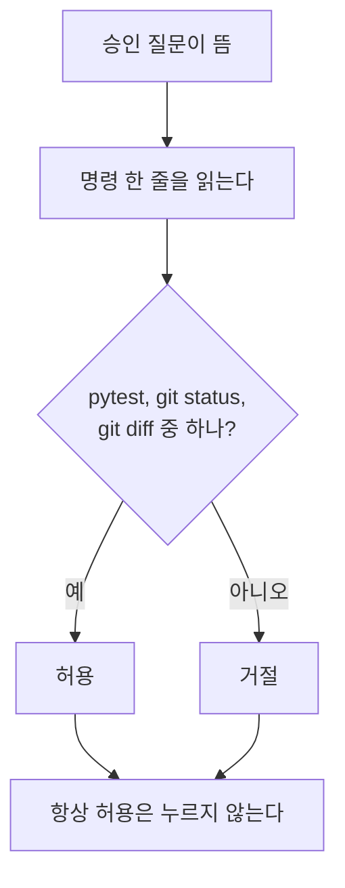

# Copilot과 agy 사용 안내

> © 2026 김연지. All rights reserved. 수강생 개인 학습용 · 무단 강의·복제·배포·수정 금지 · [LICENSE.md](../LICENSE.md)

이 문서는 오늘 쓰는 AI 도구 두 가지의 사용법입니다. VS Code의 GitHub Copilot과 터미널의 agy를 둘 다 직접 씁니다.

> 안전 규칙
> - AI 채팅에 비밀번호, API 키, 실제 고객 정보, 회사 코드는 넣지 않습니다.
> - 결제 수단은 어디에도 등록하지 않습니다.

편집기 단축키는 Mac에서 `Ctrl` 대신 `Cmd`를 씁니다. 단, 터미널에서 서버를 끄는 `Ctrl+C`는 Mac도 `Ctrl`이고, Copilot 채팅 패널 단축키는 아래 표처럼 다릅니다.

## 1. AI 코딩 도구 3단계

| 단계 | 하는 일 | 조심할 점 |
|---|---|---|
| 자동완성 | 치는 중에 회색 글씨로 다음 코드를 제안 | Tab은 수락, Esc는 거절 |
| 채팅 | 질문하고 답을 받음. 코드는 내가 옮김 | 그럴듯한 답을 그대로 믿기 쉬움 |
| 에이전트 | 파일을 직접 고치고 명령을 실행 | 내가 모르는 사이 많이 바뀜 |

Tab을 무심코 누르는 것이 가장 위험합니다. 제안을 읽고 나서 누릅니다.

## 2. Copilot 상태 점검

1. VS Code 아래 상태표시줄에 Copilot 아이콘이 있는지 봅니다.
2. 아이콘을 눌러 내 GitHub 계정 이름이 보이는지 봅니다.
3. 빈 `.py` 파일을 만들어 `# 두 수를 더하는 함수`를 쓰고 `Enter`를 칩니다. 회색 제안이 뜨면 성공입니다. 확인한 뒤 파일은 저장하지 않고 닫습니다.

안 뜨면 순서대로 해 봅니다.

1. 파일 확장자가 `.py`인지 봅니다.
2. VS Code를 다시 시작합니다.
3. Copilot에서 로그아웃한 뒤 다시 로그인합니다.

## 3. Copilot 단축키

| 하는 일 | Windows | Mac |
|---|---|---|
| 인라인 채팅 (코드 바로 옆) | `Ctrl+I` | `Cmd+I` |
| 채팅 패널 열기 | `Ctrl+Alt+I` | `Ctrl+Cmd+I` |
| 단축키가 안 될 때 | `Ctrl+Shift+P` → "Copilot" 입력 → 고르기 | `Cmd+Shift+P` → "Copilot" 입력 → 고르기 |

채팅 패널은 VS Code 맨 위 가운데 검색창 옆의 채팅 아이콘으로도 엽니다.

인라인 채팅은 이렇게 씁니다.

1. 코드를 선택합니다.
2. `Ctrl+I`(Mac `Cmd+I`)를 누릅니다.
3. 부탁을 씁니다.
4. 고치기 전과 후가 나란히 보입니다.
5. 수락 또는 거절을 누릅니다.

선택한 코드는 AI가 자동으로 봅니다.

## 4. Copilot 모드 세 가지

| 모드 | 하는 일 | 쓰는 때 |
|---|---|---|
| Ask | 질문에 답만 합니다. 코드를 고치지 않습니다 | 설명 듣기, 명세 쓰기 |
| Agent | 파일을 고치고 명령을 실행합니다 | 테스트 만들기, 구현하기 |
| Plan | 고치기 전에 단계별 계획을 먼저 보여 줍니다 (버전에 따라 안 보입니다) | 큰 일을 시키기 전 |

모드는 채팅 입력창 아래의 드롭다운에서 고릅니다. Ask와 Agent가 보이면 성공입니다.

Agent 모드는 세션당 2~3번만 씁니다. 무료 한도가 작습니다.

Agent가 명령 실행 승인을 물으면 아래 순서로 정합니다.



삭제 명령은 거절합니다.

## 5. AI는 내가 보여 준 것만 압니다

| 방법 | 쓰는 법 |
|---|---|
| 코드 선택 | 코드를 드래그해서 고른 뒤 채팅 |
| 파일 끌어놓기 | 탐색기의 파일을 채팅창으로 드래그 |
| `#selection` | "`#selection`이 뭐 하는 코드야?" |
| `@terminal` | 터미널 에러를 물을 때. "`@terminal` 에러 왜 나?" |
| `@vscode` | VS Code 사용법을 물을 때 |

채팅 첫 줄에 "먼저 AGENTS.md를 읽어 주세요"를 쓰거나 파일을 붙입니다. 설정에 따라 자동으로 읽지 않기 때문입니다.

## 6. Copilot 슬래시 명령

| 명령 | 뜻 |
|---|---|
| `/explain` | 선택한 코드를 설명 |
| `/fix` | 문제를 찾아 고침 (Agent에서는 파일이 바뀔 수 있습니다) |
| `/tests` | 테스트를 만들어 줌 |
| `/doc` | 설명 글(주석)을 달아 줌 |
| `/clear` | 대화를 비우고 새로 시작 |

엉뚱한 답이 계속 나오면 `/clear`부터 합니다.

## 7. agy (터미널 에이전트)

agy는 터미널에서 쓰는 AI 에이전트입니다. Copilot처럼 파일을 읽고 고칩니다.

| 하는 일 | 방법 |
|---|---|
| 설치 확인 | `agy --version` |
| 켜기 | 프로젝트 폴더의 터미널에서 `agy` 입력 |
| 스킬 목록 보기 | agy 대화 화면에서 `/` 입력 |
| 스킬 위치 | `.agents/skills/<이름>/SKILL.md` (Copilot과 같은 곳) |

- 처음 켤 때 내 Google 계정으로 로그인합니다. 비밀번호는 로그인 화면에만 입력하고 AI 채팅에는 넣지 않습니다.
- agy는 프로젝트의 AGENTS.md를 규칙으로 자동으로 읽습니다(Antigravity 문서 "Rules"). 그래도 중요한 부탁에는 "AGENTS.md를 지켜 줘"를 한 번 더 씁니다.
- 스킬은 명령처럼 부릅니다. 예: `/spec-to-tests to_label to_temperature is_mismatch` (함수 이름을 모두 적어야 표 전체가 테스트가 됩니다)

### 실행 허락 창

agy가 명령을 실행하려 하면 허락 창이 뜹니다. ↑↓로 고르고 Enter를 누릅니다.

| 번호 | 뜻 | 언제 |
|---|---|---|
| 1 | 이번 한 번만 허락 | 처음 보는 명령, 파일을 바꾸는 명령 |
| 2 | 이 대화 동안 같은 명령은 다시 묻지 않음 | `git status`, `git diff`, `pytest` |
| 3 | 설정 파일에 저장해 앞으로 계속 허락 | 수업에서는 쓰지 않습니다 |
| 4 | 취소 | `git push`, 파일 삭제, `pip install` 같은 예상 못 한 명령 |

매번 묻지 않게(auto) 하려면 `/permissions`에서 바꾸거나, 홈 폴더의 `.gemini/antigravity-cli/settings.json`에 아래를 넣고 agy를 다시 켭니다.

```json
{ "toolPermission": "always-proceed" }
```

기본값은 `request-review`(매번 묻기)입니다. `always-proceed`는 push나 삭제도 묻지 않고 실행하므로 되돌릴 수 있는 연습 폴더에서만 쓰고, 끝나면 지웁니다.

- agy가 켜진 터미널에서는 다른 명령을 치지 않습니다. `pytest`, `git`은 다른 터미널에서 칩니다.
- agy가 한 일도 믿지 않습니다. `pytest -v`와 `git diff --stat`으로 직접 확인합니다.

## 8. 함정 3가지

1. 그럴듯한 설명을 그대로 믿기: 직접 실행해서 확인합니다(`pytest`, 화면).
2. 전체를 새로 써 버리기: "바뀌는 부분만 보여 줘. 전체를 다시 쓰지 마."
3. 대화가 길어지면 조건을 잊음: `/clear` 후 조건을 처음부터 다시 말합니다.

## 9. 우리가 지킬 세 가지

1. 다 넣지 않기: API 키, 비밀번호, 진짜 고객 정보, 회사 코드는 AI 창에 붙여 넣지 않습니다.
2. 사람이 보기: 실행해 보기 전까지는 모릅니다. AI가 "고쳤다"고 해도 증거가 아닙니다.
3. 남기기: 왜 이 코드를 골랐는지 commit 메시지에 한 줄 적습니다.

## 한도가 끝났다면

Copilot이나 agy 한쪽의 한도가 끝나면 남은 쪽으로 같은 부탁을 이어 갑니다. 작업 내용은 `AGENTS.md`, `SPEC.md`, commit에 남아 있어서 다른 도구가 이어받습니다. 둘 다 막히면 `docs/00-troubleshooting.md`의 백업 경로(브라우저 채팅, 따라잡기 브랜치)를 씁니다.

프롬프트 쓰는 법은 `docs/01-prompt-sheet.md`에 있습니다.
