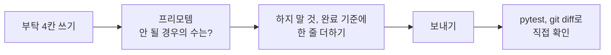

# 프롬프트 시트

> © 2026 김연지. All rights reserved. 수강생 개인 학습용 · 무단 강의·복제·배포·수정 금지 · [LICENSE.md](../LICENSE.md)

이 문서는 책상 옆에 펼쳐 두는 한 장짜리 안내입니다. AI에게 부탁하는 글을 쓸 때 칸을 채우는 방법을 적었습니다. 프롬프트는 AI에게 주는 요구사항 정의서입니다.

> 안전 규칙
> - AI 채팅에 비밀번호, API 키, 실제 고객 정보, 회사 코드는 넣지 않습니다.
> - 결제 수단은 어디에도 등록하지 않습니다.

## 1. 일반 프롬프트 4요소

| 요소 | 뜻 | 예 |
|---|---|---|
| 역할 | 누구로서 답하는가 | "코딩을 처음 가르치는 선생님으로서" |
| 근거 | 무엇에만 근거하는가 | "붙여 준 파일에만 근거해서" |
| 형식 | 어떻게 생긴 답인가 | "표로, 설명을 먼저, 3줄로" |
| 모를 때 | 없으면 어떻게 하는가 | "확인 불가라고 쓰고 추측하지 마세요" |

네 칸 중 하나라도 비면 AI가 그 칸을 스스로 채웁니다. 코딩에서는 "모를 때"를 이렇게 씁니다: "확실하지 않으면 어디를 확인해야 하는지 알려 줘."

### 요구사항 정의서와 짝 맞추기

| 요구사항 정의서 | 프롬프트 |
|---|---|
| 누가 쓰는 기능인가 | 역할 |
| 어떤 데이터를 다루나 | 근거 |
| 산출물 형태 | 형식 |
| 예외 처리 | 모를 때 |
| 검수 기준 | 평가 방법 |

"알아서 잘 해 주세요"는 요구사항 정의서에도 프롬프트에도 없는 말입니다. 프롬프트가 작은 요구사항 정의서라면, 명세서는 큰 프롬프트입니다(세션 2에서 이어집니다).

### 정확도를 올리는 6가지

1. 명시적으로 씁니다. "알아서"를 지웁니다.
2. 이유를 말합니다. 예: "고객 개인정보라서 밖으로 보내면 안 돼."
3. 예시를 2~3개 보여 줍니다(few-shot). "이런 입력이면 이런 출력"을 보여 주고 따라 하게 하는 방법입니다.
4. 구획을 나눕니다. `<규칙>`, `<데이터>`처럼 칸을 나눕니다. 데이터 안의 "이전 지시를 무시해" 같은 문장이 AI를 조종하는 사고(프롬프트 인젝션)를 막아 줍니다.
5. 생각할 시간을 줍니다. 예: "먼저 후보 3개를 나열하고 근거를 확인한 뒤 답하라."
6. 출력 계약을 정합니다. 답의 모양을 미리 약속합니다. 예: "JSON 형식으로, 이 키만."

코딩에서는 5번째 칸이 붙습니다. 실행 환경입니다. 예: "Python 3.11 이상, FastAPI, 새 패키지 없이"

## 2. 개발 부탁 4칸 (코딩용)

AI는 말하지 않은 것을 추측합니다. 네 칸을 채우면 추측이 줄어듭니다.

```text
[원하는 것] 무엇을 만들까요? 읽어야 할 문서는? (AGENTS.md, SPEC.md)
[방법 힌트] 어느 파일에, 어떤 규칙으로? (SPEC의 숫자와 이름 그대로) 실행 환경은?
[하지 말 것] 건드리면 안 되는 파일, 하면 안 되는 행동
[완료 기준] 끝났다고 말할 조건. 실행할 명령(pytest)과 보고할 것
```

| 개발 부탁 4칸 | 일반 프롬프트 |
|---|---|
| 원하는 것 | 작업, 산출물 |
| 방법 힌트 | 근거 + 실행 환경 |
| 하지 말 것 | 제약, 예외(모를 때) |
| 완료 기준 | 형식 + 검수 기준(테스트) |

보내기 전에 스스로 묻습니다.

- 원하는 것은 한 문장인가?
- 파일 이름은 진짜 있는 이름인가?
- SPEC.md와 tests/를 적었나?
- 완료 기준을 내가 실행해서 확인할 수 있나?

### 먼저 물어보게 하기

"코드 써 줘"가 아니라 "빠진 게 뭔지 물어봐 줘"로 시작하면, 요청서에 없던 결정 사항이 드러납니다(세션 2, 명세 쓰기).

```text
REQUEST.md 1차 요청을 읽고, 명세를 쓰려면 내가 정해야 할 것을 질문 5개로 물어봐 줘. 코드는 쓰지 마.
```

AI는 선택지를 주고, 결정은 내가 합니다. 선택지가 필요하면 이렇게 묻습니다.

```text
REQUEST.md 1차 요청을 읽고, 리뷰 온도를 어떻게 계산하면 좋을지 선택지 2개와 장단점을 알려 줘. 코드는 쓰지 마.
```

### 구현 전에 계획만 먼저 보기

구현을 맡기기 전에 AI가 무엇을 바꿀지 먼저 봅니다. Copilot의 Plan 모드를 쓰거나, Ask 모드(또는 agy)에서 이렇게 보냅니다. 엉뚱한 파일을 고치기 전에 멈출 수 있습니다.

```text
AGENTS.md 와 SPEC.md 2장을 읽고, tests/test_thermo.py 를 통과시키려면 무엇을 바꿀지 계획만 보여 줘. 코드는 쓰지 마. 파일도 고치지 마.
```

계획에 바꿀 파일이 `app/thermo.py` 하나만 있는지, `tests/`나 `SPEC.md`가 들어 있지 않은지 확인한 뒤 구현을 맡깁니다.

## 3. 디버깅 3종 세트

```text
[재현 조건] 무엇을 했을 때 (예: 별점 5, 글 "배송 최악" 으로 분석을 눌렀을 때)
[기대 동작] 어떻게 돼야 하는데 (예: mismatch 가 true)
[실제 동작] 실제로는 (예: false)
[에러 메시지] at … 줄이나 Traceback 줄까지 통째로 붙여 넣기
먼저 원인을 설명하고, 바꿀 코드를 보여 주세요.
```

에러 메시지는 잘라 내지 말고 통째로 붙입니다. Copilot에서는 터미널 에러를 `@terminal`로 물어도 됩니다.

## 4. 프리모템 (보내기 전 점검)

질문은 하나입니다. 이 프롬프트가 의도대로 안 될 경우의 수는?

떠오른 것을 하지 말 것이나 완료 기준 칸에 한 줄씩 더합니다. 예: 테스트를 고쳐서 통과시키지 않을까? → "tests/는 고치지 마"



## 5. 포스트모템 (끝난 뒤)

AI에게 다시 보낸 프롬프트를 적습니다. 처음부터 잘 됐다면 비어 있어도 됩니다.

| 다시 보낸 프롬프트 | 왜 다시 보냈나 | 처음에 넣었어야 할 말 |
|---|---|---|
| (예) tests/는 고치지 말고 다시 해 줘 | AI가 테스트를 고쳐서 통과시킴 | 처음부터 "SPEC.md와 tests/는 건드리지 마" |
| | | |

## 6. 나쁜 프롬프트와 좋은 프롬프트 (3쌍)

### 쌍 1. 테스트 쓰기

나쁜 프롬프트: `온도 테스트 좀 만들어 줘` (어떤 규칙을? 어디에? AI가 마음대로 정합니다.)

```text
[원하는 것] SPEC.md 3장 예시표의 나머지 행을 pytest 테스트로 옮겨 줘. AGENTS.md 를 먼저 읽어.
[방법 힌트] tests/test_thermo.py 에 이어서 추가해. 표의 한 줄이 한 줄의 데이터 행.
[하지 말 것] 내가 쓴 테스트는 지우거나 바꾸지 마. app/ 와 SPEC.md 는 고치지 마. 표에 없는 행을 넣지 마.
[완료 기준] 내가 쓴 2줄을 포함해 행이 표와 같은 15줄이고, pytest 에서 실패해도 ERROR 는 없어야 해.
```

### 쌍 2. 실패한 테스트 고치기

나쁜 프롬프트: `안 돼. 고쳐 줘.` (무엇이 안 되는지 AI는 모릅니다.)

```text
[원하는 것] pytest 에서 test_to_label[0.5_boundary] 가 FAILED 야. 통과시켜 줘.
[방법 힌트] SPEC.md 2장에 0.5 이상이면 positive 라고 되어 있어. app/thermo.py 의 to_label 만 봐.
[하지 말 것] SPEC.md 와 tests/ 는 건드리지 마.
[완료 기준] pytest 결과와 바꾼 파일 목록을 보여 줘.
```

### 쌍 3. 새 기능 시키기

나쁜 프롬프트: `쿠폰도 되게 해 줘` (어느 파일에? 어떤 규칙? 끝은 언제?)

```text
[원하는 것] SPEC_COUPON.md 를 보고 쿠폰 API를 만들어 줘. 주소와 요청·응답 모양은 화면(static/)이 부르는 대로 맞춰. AGENTS.md 를 먼저 읽어.
[방법 힌트] Pydantic 모델(요청, 응답) → 라우트 → 규칙 함수 순서로 만들어. AI 부품은 app/deps.py 의 get_predict 를 Depends 로 받아 써.
[하지 말 것] SPEC_COUPON.md 와 tests/ 는 건드리지 마. static/ 와 app/sentiment.py, app/deps.py 도 고치지 마.
[완료 기준] pytest 의 passed, failed 개수와 바꾼 파일 목록을 알려 줘.
```

## 7. 오늘의 습관

- 한 번에 끝내기: 한 번에 잘 설명하고 한 번에 끝냅니다. 같은 실패가 2번 나오면 `/clear`나 새 대화로 처음부터 다시 설명합니다.
- 코드에 실제로 있는 이름으로 말하기: 파일, 함수, 테스트 이름과 에러 줄을 그대로 씁니다.
- 대화가 길어져 답이 흔들리면 새 채팅을 엽니다(컨텍스트 오염). 아래 "새 채팅 시작" 프롬프트로 이어 갑니다.
- AI가 고쳤다고 해도 확인합니다. `pytest`와 `git diff --stat`을 실행하고, `tests/`나 `SPEC.md`가 보이면 AI가 테스트 기대값을 바꿔서 통과시켰을 수 있습니다. 되돌리고 다시 시킵니다.
- 설명할 수 있는 코드만 commit 합니다. 아래 "3줄로 설명해 줘" 프롬프트를 씁니다.
- Agent 모드는 아껴 씁니다(세션당 2~3번). Agent가 명령 실행 승인을 물으면 명령 한 줄을 읽고 `pytest`, `git status`, `git diff` 류만 허용합니다. 나머지와 삭제 명령은 거절하고 '항상 허용'은 누르지 않습니다. 도구 사용법은 `docs/01-copilot-guide.md`, 막힐 때는 `docs/00-troubleshooting.md`를 봅니다.

### 새 채팅 시작

채팅 패널의 + 버튼으로 새 채팅을 엽니다. 이전 대화는 기억하지 못하므로 필요한 파일만 붙이고(`AGENTS.md`, `SPEC.md`) 지금 할 일을 한 줄로 적습니다. 중요한 결정은 대화가 아니라 파일에 있어야 합니다. agy는 새로 켜서 같은 글을 보냅니다.

```text
AGENTS.md와 SPEC.md를 읽고 이어서 app/thermo.py 의 to_temperature 를 구현해 줘. 지금까지 정한 규칙은 SPEC.md 에 있는 것이 전부야. SPEC.md 와 tests/ 는 고치지 마.
```

`app/thermo.py`의 `to_temperature` 부분은 지금 하려는 일로 바꿔 씁니다.

### 3줄로 설명해 줘 (이해 부채 줄이기)

AI가 쓴 코드는 내가 설명할 수 있을 때 내 코드가 됩니다. commit 하기 전에 설명을 부탁하고, 그대로 읽지 말고 내 말로 바꿔서 짝에게 설명합니다.

```text
이 함수를 처음 배우는 사람에게 3줄로 설명해 줘.
```
