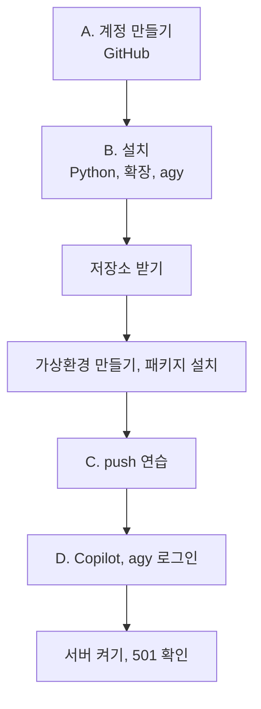

# 환경설정 카드

> © 2026 김연지. All rights reserved. 수강생 개인 학습용 · 무단 강의·복제·배포·수정 금지 · [LICENSE.md](../LICENSE.md)

이 문서는 수업 시작 때 위에서 아래로 따라 하는 설정 순서입니다. 끝나면 서버가 켜지고 화면에 501이 보입니다.

AI와 함께 코딩하며 SDD·TDD 시작하기 · 현대경제연구원 · 강사 김연지

> 안전 규칙
> - AI 채팅에 비밀번호, API 키, 실제 고객 정보, 회사 코드는 넣지 않습니다.
> - 결제 수단은 어디에도 등록하지 않습니다.
> - GitHub, Copilot, agy 어디서도 카드를 등록하지 않습니다. 카드 입력 화면이 나오면 멈추고 손을 듭니다. 오늘은 전부 무료로 진행합니다.

이 카드대로 하면 Python, VS Code 확장, agy를 설치하고 서버까지 켭니다. VS Code와 Git이 없는 개인 PC라면 맨 아래 '개인 PC로 들을 때'부터 봅니다.

명령은 저장소 `README.md`의 「명령 복사 블록」에서 복사 버튼으로 복사해 붙여 넣어도 됩니다. 아래에 (README 블록 N)으로 번호를 적어 두었습니다.

- 명령은 모두 VS Code 안의 터미널에서 칩니다. Windows는 PowerShell, macOS는 기본 터미널입니다.
- Mac은 편집기 단축키(`Ctrl+S`, `Ctrl+Shift+P`, `Ctrl+F` 등)에서만 `Ctrl` 대신 `Cmd`를 씁니다. 서버를 끄는 `Ctrl+C`는 Mac도 `Ctrl`입니다.
- 키는 Windows / Mac 순서로 적습니다.

낯선 말은 이렇습니다.

| 말 | 뜻 |
|---|---|
| 터미널 | 글자로 컴퓨터에 일을 시키는 창 |
| 저장소(repository) | 코드를 모아 두는 GitHub의 폴더 |
| 가상환경(venv) | 이 프로젝트만 쓰는 파이썬 상자 |

## 설정 순서



## A. 계정 만들기 (브라우저)

- [ ] 1. GitHub 가입: github.com → Sign up → 이메일 인증까지 끝냅니다.
- [ ] 2. 내 저장소 만들기: 강사가 알려 준 템플릿 주소 → Use this template → Create a new repository
  - 이름은 `review-thermo`, 공개는 Public
  - Include all branches를 꼭 체크합니다.

카드 입력 화면이 나오면 멈추고 손을 듭니다.

## B. VS Code 안에서

- [ ] 3. VS Code를 실행하고 메뉴 Terminal → New Terminal을 엽니다.
  - 처음 열면 "이 폴더를 신뢰합니까?" 창이 뜹니다. Yes, I trust the authors를 누릅니다.
  - 오른쪽 아래의 "추천 확장" 알림은 닫습니다(X).
- [ ] 3-1. 확인 (README 블록 ①): `git --version`, `code --version`에 버전이 나오면 됩니다.
  - `git`을 찾을 수 없다는 글이 나오면 git-scm.com → Download로 설치한 뒤 VS Code를 다시 엽니다.
- [ ] 3-2. Python 설치: 브라우저에서 python.org → Downloads → Python 3.12를 내려받아 실행합니다.
  - Windows: 첫 화면 아래 **Add python.exe to PATH**를 꼭 체크하고 Install Now를 누릅니다.
  - macOS: 설치 화면을 끝까지 진행합니다.
  - 설치가 끝나면 VS Code를 완전히 닫았다가 다시 엽니다. 그래야 새 터미널이 Python을 찾습니다.
  - 확인: Windows `python --version`, macOS `python3 --version` → `Python 3.12.x`
  - Windows에서 Microsoft Store가 열리면 `py --version`으로 확인하고, 이후 `python` 대신 `py`를 씁니다.
- [ ] 3-3. VS Code 확장 설치: 왼쪽 Extensions(네모 4개 아이콘)에서 아래를 검색해 Install 합니다. 이미 있으면 넘어갑니다.
  - `Python` (Microsoft)
  - `GitHub Copilot Chat`
- [ ] 3-4. Windows만, 실행 허용(한 번만): `Set-ExecutionPolicy -Scope CurrentUser RemoteSigned`. 묻는 창에는 `Y`를 씁니다.
- [ ] 3-5. agy 설치 (README 블록 ①-2)

Windows PowerShell:

```powershell
irm https://antigravity.google/cli/install.ps1 | iex
```

macOS:

```bash
curl -fsSL https://antigravity.google/cli/install.sh | bash
```

설치가 끝나면 터미널 오른쪽 위 `+`로 새 터미널을 열고 `agy --version`을 칩니다. 버전이 나오면 성공입니다. 로그인은 저장소를 받은 뒤 11-1에서 합니다.

- [ ] 4. 홈 폴더로 이동합니다. 작업 폴더를 둘 자리입니다.

macOS: `cd ~`

Windows PowerShell: `cd $HOME`

- [ ] 5. 내려받기 (README 블록 ②): `<내아이디>` 자리에 내 GitHub 아이디를 씁니다. 꺾쇠 `< >`는 뺍니다. 아이디가 `haru123`이면 `https://github.com/haru123/review-thermo.git`입니다.

```text
git clone https://github.com/<내아이디>/review-thermo.git
cd review-thermo
code -r .
```

`code -r .`는 같은 창에서 이 폴더를 다시 엽니다. 안 되면 메뉴 File → Open Folder로 `review-thermo`를 엽니다. 폴더가 바뀌면 터미널이 닫힙니다. Terminal → New Terminal로 다시 엽니다.

- [ ] 6. git 이름 설정 (README 블록 ③, 처음 한 번만)

```text
git config --global user.name "내 이름"
git config --global user.email "GitHub 가입 이메일"
```

Public 저장소에서는 commit에 이메일이 보입니다. 원하지 않으면 GitHub Settings → Emails의 noreply 주소를 씁니다.

- [ ] 7. 가상환경 만들기, 패키지 설치 (README 블록 ④ macOS, ⑤ Windows)
  - Windows 순서: 실행 허용(3-4에서 했으면 건너뜀) → 가상환경 만들기 → 켜기 → 패키지 설치

macOS:

```bash
python3 -m venv .venv
source .venv/bin/activate
pip install -r requirements.txt
```

Windows PowerShell:

```powershell
Set-ExecutionPolicy -Scope CurrentUser RemoteSigned
python -m venv .venv
.venv\Scripts\Activate.ps1
pip install -r requirements.txt
```

- `Set-ExecutionPolicy`는 내 계정에서 스크립트 실행을 허용하는 명령입니다. 한 번만 합니다. 묻는 창에는 `Y`를 씁니다.
- 안 켜지면 터미널 오른쪽 위의 ▼ → Command Prompt를 열고 `.venv\Scripts\activate.bat`를 칩니다. PowerShell 창에서 `activate.bat`을 치면 안 됩니다.
- 급할 때는 켜지 않고 경로로 실행해도 됩니다. 예: `.venv\Scripts\python -m pytest -v`

터미널 앞에 `(.venv)`가 보이면 성공입니다.

- [ ] 8. 파이썬 선택: `Ctrl+Shift+P`(Mac `Cmd+Shift+P`) → Python: Select Interpreter → `.venv`가 붙은 것을 고릅니다.
  - Python: Select Interpreter가 안 보이면 왼쪽 Extensions(네모 4개 아이콘)에서 `Python`을 검색해 Install 합니다.
  - 이렇게 해 두면 새 터미널을 열어도 `(.venv)`가 자동으로 켜집니다.

## C. push 연습

- [ ] 9. `README.md` 첫 줄 끝에 내 이름을 적고 저장합니다(`Ctrl+S`, Mac `Cmd+S`).
- [ ] 10. 터미널에서 저장하고 올립니다 (README 블록 ⑨). `"메시지"` 자리에는 `"README에 이름 추가"`를 씁니다.

```text
git add .
git commit -m "README에 이름 추가"
git push
```

- 로그인 창이 뜨면 Sign in with browser(GitHub)를 고릅니다.
- GitHub 저장소 화면에 새 commit이 보이면 성공입니다.

## D. AI 도구와 서버

- [ ] 11. Copilot Free: VS Code 맨 위 가운데 검색창 옆의 채팅 아이콘을 누릅니다. 단축키는 Windows `Ctrl+Alt+I`, Mac `Ctrl+Cmd+I`입니다.
  - Sign in → GitHub 로그인 → 무료로 시작
  - Chat에 `안녕`을 쓰고 답이 오면 성공입니다.
  - 모드 드롭다운은 입력창 아래에 있습니다. Ask와 Agent가 보이면 성공입니다(Plan은 버전에 따라 보입니다).
  - 자세한 내용은 `docs/01-copilot-guide.md`
- [ ] 11-1. agy 로그인: 새 터미널을 열고 프로젝트 폴더에서 `agy`를 입력합니다. 로그인 안내가 나오면 내 Google 계정으로 로그인합니다.
  - Google 비밀번호는 브라우저의 로그인 화면에만 입력합니다. AI 채팅에는 넣지 않습니다.
  - 결제 수단은 등록하지 않습니다.
  - 대화 화면이 열리면 `안녕`을 쓰고 답이 오면 성공입니다.
  - agy가 켜진 터미널에서는 다른 명령을 치지 않습니다. `pytest`, `git`은 다른 터미널에서 칩니다.
- [ ] 12. 서버 켜기 (README 블록 ⑥)

```text
uvicorn app.main:app --reload
```

브라우저에서 `http://localhost:8000`을 엽니다. 리뷰를 넣고 분석을 누르면 "아직 구현되지 않았어요 (501)"가 나옵니다. 아직 아무것도 안 만들었으니 정상입니다.

- 서버를 끄려면 터미널에서 `Ctrl+C`(Mac도 `Ctrl`)를 누릅니다.
- 서버가 켜진 터미널은 그대로 두고, 새 터미널을 열어 다른 명령을 칩니다.

> 주의: Copilot Agent나 agy가 자기 터미널을 따로 열 수 있습니다. 그 결과는 믿지 않습니다. `(.venv)`가 켜진 내 터미널에서 `pytest`를 직접 실행합니다. `review-thermo` 폴더 안에서 실행해야 합니다. 아니면 먼저 `cd review-thermo`를 칩니다.

## 개인 PC로 들을 때

VS Code와 Git이 없다면 먼저 설치합니다. 나머지는 B절과 같습니다.

1. VS Code: code.visualstudio.com → Download
2. Git: git-scm.com → Download
3. 그다음 B절 3번부터 따라 합니다 (Python, VS Code 확장, agy 설치).

## 자주 막히는 곳

| 증상 | 해결 |
|---|---|
| `python` 명령이 없다 / Windows에서 Microsoft Store가 열린다 | macOS는 `python3`, Windows는 `py`로 바꿉니다. 설치할 때 Add python.exe to PATH 체크를 놓친 경우입니다. 설치 파일을 다시 실행해 체크해도 됩니다 |
| `agy` 명령이 없다 | 설치 뒤 새 터미널을 열지 않은 경우가 많습니다. 터미널 `+`로 새로 열고 다시 칩니다. 그래도 없으면 3-5를 다시 하고 손을 듭니다 |
| `Python: Select Interpreter`가 안 보인다 | 왼쪽 Extensions(네모 4개 아이콘)에서 Python 검색 → Install |
| `pip install`이 느리다 | 다 같이 받으면 느립니다. 기다립니다 |
| `code` 명령이 없다 | File → Open Folder로 폴더를 엽니다 |
| 한도(quota) 초과 | 강사에게 알립니다. 남은 도구로 이어 가거나 브랜치로 따라잡습니다 |
| 그 밖의 화면 메시지 | `docs/00-troubleshooting.md` |
