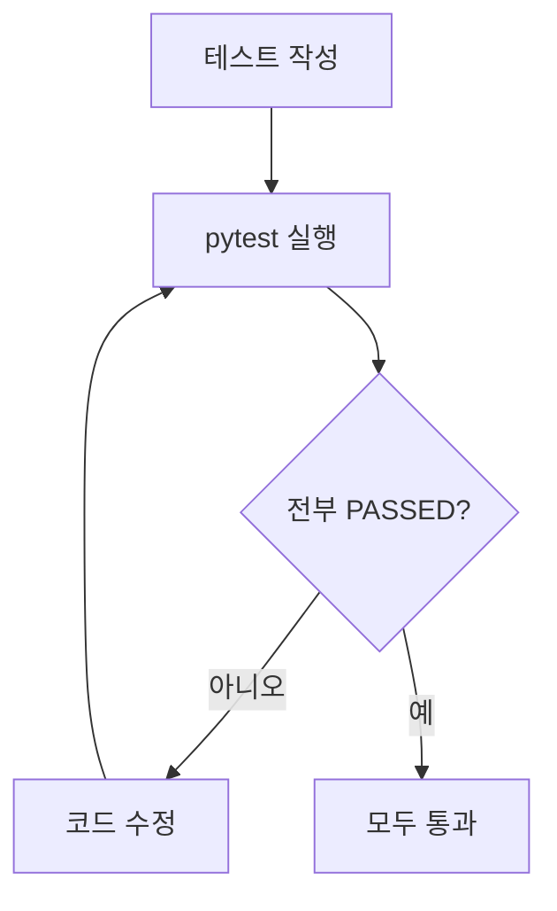

# pytest 소개

> © 2026 김연지. All rights reserved. 수강생 개인 학습용 · 무단 강의·복제·배포·수정 금지 · [LICENSE.md](../LICENSE.md)

이 문서는 pytest가 무엇이고 어떻게 돌리는지 설명합니다. `pytest`를 처음 돌리기 전에 읽습니다.

## pytest란

pytest는 파이썬 코드를 자동으로 시험하는 도구입니다.

AI가 만든 코드가 맞는지 사람이 눈으로 다 보기는 어렵습니다. 그래서 "이 입력이면 이 결과"를 테스트로 적어 두고, pytest가 대신 확인합니다.

- 통과하면 `PASSED`
- 틀리면 `FAILED`

## 테스트 한 줄 만들기

규칙은 세 가지입니다.

1. 테스트 파일 이름은 `test_`로 시작합니다. 예: `tests/test_thermo.py`
2. 테스트 함수 이름도 `test_`로 시작합니다. 예: `test_to_label`
3. 함수 안에 `assert`(단언, "이래야 한다") 한 줄을 씁니다.

```python
from app.thermo import to_label

def test_to_label_half():
    assert to_label(0.5) == "positive"
```

`to_label(0.5)`의 결과가 `"positive"`가 아니면 이 테스트는 실패합니다.

## 실행하기

`(.venv)`가 켜진 터미널에서, `review-thermo` 폴더 안에서 실행합니다.

| 하고 싶은 일 | 명령 |
|---|---|
| 전체 실행 | `pytest` |
| 한 줄씩 결과 보기 | `pytest -v` |
| 파일 하나만 | `pytest tests/test_thermo.py -v` |
| 이름에 글자가 들어간 테스트만 | `pytest -k to_label -v` |

`-k` 뒤에는 테스트 이름의 일부를 씁니다. 위 명령은 이름에 `to_label`이 들어간 테스트만 돌립니다.

`pytest` 대신 `python -m pytest -v`라고 치면, 지금 켜진 가상환경의 pytest를 확실히 씁니다. 결과 맨 위 `platform ...` 줄의 경로에 `.venv`가 들어 있으면 맞게 돈 것입니다.

## 첫 연습: warmup 버그를 테스트로 잡기

`warmup/orders.py`에는 일부러 넣은 버그가 있습니다. 그중 하나를 테스트로 적어 봅니다.

```python
# warmup/test_orders.py
from warmup.orders import get_page


def test_first_page():
    assert get_page(list(range(25)), 1) == list(range(10))
```

```text
python -m pytest warmup -v
```

`FAILED`가 나오면 버그를 테스트로 잡은 것입니다. `pytest`만 치면 `tests/` 폴더만 돌기 때문에, warmup 폴더는 이렇게 폴더 이름을 적어야 돕니다.

## 결과 읽기

`pytest -v`를 돌리면 테스트 한 건이 한 줄로 나옵니다.

```text
tests/test_thermo.py::test_to_label[0.9] PASSED
tests/test_thermo.py::test_to_label[0.5_boundary] PASSED
tests/test_thermo.py::test_to_temperature[0.8732] FAILED
```

맨 아래에는 요약 줄이 있습니다. 세션 2의 Red 단계에서는 이런 줄이 나옵니다.

```text
============ 17 failed, 4 passed in 0.5s ============
```

| 표시 | 뜻 |
|---|---|
| PASSED | 통과 |
| FAILED | 기대와 결과가 다름 |
| ERROR | 테스트를 돌리기 전에 문제가 있음 (파일 이름, 오타 등) |

### 실패 메시지 읽기

FAILED가 나오면 위쪽에 이유가 나옵니다. 아래는 테스트의 기대값을 일부러 `"negative"`로 바꿨을 때의 실제 화면입니다.

```text
score = 0.9, expected = 'negative'

>       assert to_label(score) == expected
E       AssertionError: assert 'positive' == 'negative'
E         - negative
E         + positive
```

읽는 순서입니다.

1. `>` 표시가 있는 줄이 실패한 줄입니다.
2. `AssertionError`는 "assert가 틀렸다"는 뜻입니다.
3. `assert 'positive' == 'negative'`에서 왼쪽이 코드가 돌려준 실제 값, 오른쪽이 테스트가 기대한 값입니다.
4. 이 경우 코드는 `positive`를 줬고, 테스트는 `negative`를 기대했습니다.

세션 2 처음에는 `NotImplementedError`가 보입니다. 함수를 아직 만들지 않았다는 뜻이고, Red 단계에서는 정상입니다.

## 표 한 줄 = 테스트 한 줄

이 저장소의 `tests/test_thermo.py`는 `@pytest.mark.parametrize`를 씁니다. 함수 하나에 데이터 줄을 여러 개 넘겨서, 줄마다 테스트 한 건이 됩니다.

```python
LABEL_CASES = [
    pytest.param(0.9, "positive", id="0.9"),
    pytest.param(0.5, "positive", id="0.5_boundary"),
    pytest.param(0.4999, "negative", id="0.4999"),
    pytest.param(0.1, "negative", id="0.1"),
]

@pytest.mark.parametrize("score, expected", LABEL_CASES)
def test_to_label(score, expected):
    assert to_label(score) == expected
```

- `SPEC.md`의 예시표 한 줄이 `pytest.param(...)` 한 줄이 됩니다.
- `id`는 `pytest -v` 화면에 나오는 이름입니다. `test_to_label[0.5_boundary]`처럼 대괄호 안에 보입니다.
- 줄이 4개이므로 `test_to_label`은 4건으로 셉니다.

## API 테스트

화면이 보내는 요청도 테스트로 확인합니다. FastAPI의 `TestClient`가 진짜 서버를 켜지 않고 요청을 대신 보냅니다. `tests/test_api.py`의 예입니다.

```python
from fastapi.testclient import TestClient
from app.main import app

def test_health():
    r = TestClient(app).get("/health")
    assert r.status_code == 200
    assert r.json() == {"status": "ok"}
```

- `r.status_code`는 응답 번호입니다(200 성공, 422 입력 오류).
- 세션 4의 `tests/test_api_coupon.py`도 같은 모양입니다. 쿠폰 API가 없을 때는 405가 와서 실패하고, 만든 뒤에는 약속한 번호와 내용이 와서 통과합니다.
- `r.json()`은 응답 내용입니다.

리뷰를 분석하는 테스트에서는 AI 모델 대신 가짜 점수를 끼워 넣습니다(`tests/conftest.py`의 `make_client`). 모델이 바뀌어도 결과가 늘 같습니다.

```python
def test_analyze_ok(make_client):
    r = make_client(0.8732).post("/v1/reviews/analyze", json={"text": "좋아요", "rating": 5})
    assert r.status_code == 200
```

## 테스트 돌리는 순서



TDD에서는 처음에 일부러 실패를 봅니다(Red). 코드를 만든 뒤 전부 통과하면(Green) 끝입니다. 이 수업의 숫자는 아래와 같습니다.

| 시점 | pytest 마지막 줄 |
|---|---|
| 수업 시작 (`main`) | 2 failed, 4 passed |
| 내가 직접 테스트 2개를 쓴 뒤 (Red) | 4 failed, 4 passed |
| AI가 나머지 행을 추가한 뒤 (Red) | 17 failed, 4 passed |
| `app/thermo.py`를 구현한 뒤 (Green) | 21 passed |
| 쿠폰 계약 테스트를 받은 뒤 (`cp5-coupon-spec`) | 6 failed, 21 passed |
| 쿠폰 API를 만든 뒤 (Green) | 27 passed |
| 완성본 (`final`, 단위 테스트 3개 포함) | 30 passed |

AI가 내 테스트와 같은 행을 한 번 더 넣으면 Red의 failed 숫자가 17보다 커질 수 있습니다. 공식 기준은 17입니다.

## 자주 보는 오류

| 화면 | 이유 | 할 일 |
|---|---|---|
| `pytest: command not found` | 가상환경이 안 켜짐 | 터미널 앞에 `(.venv)`가 있는지 봅니다. 없으면 가상환경을 켭니다(`docs/01-setup-card.md` 7번) |
| `ModuleNotFoundError: No module named ...` | 패키지가 없거나 가상환경이 꺼짐 | `(.venv)`를 확인하고 `pip install -r requirements.txt` |
| `unexpected keyword argument 'app'` 로 API 테스트가 전부 실패 | 가상환경이 꺼져 PC의 옛 패키지로 실행됨 | 가상환경을 켜고 `pip install -r requirements.txt` 후 `python -m pytest -v` |
| `no tests ran` 또는 `file or directory not found` | 터미널이 `review-thermo` 폴더가 아님 | `cd review-thermo` 후 다시 실행 |

그 밖의 메시지는 [화면 메시지 사전](00-troubleshooting.md)에서 찾습니다.
